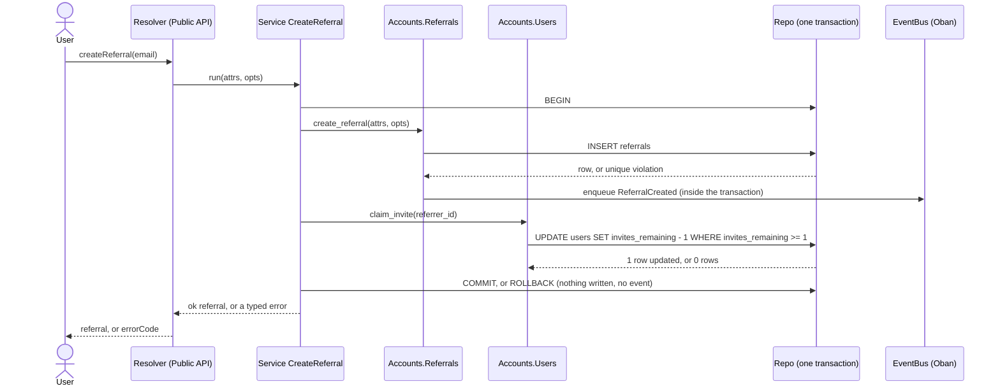
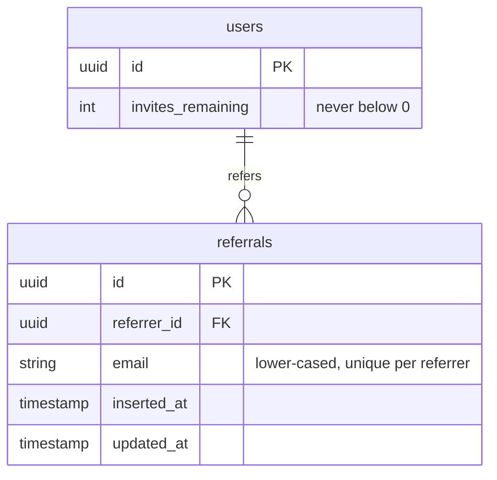
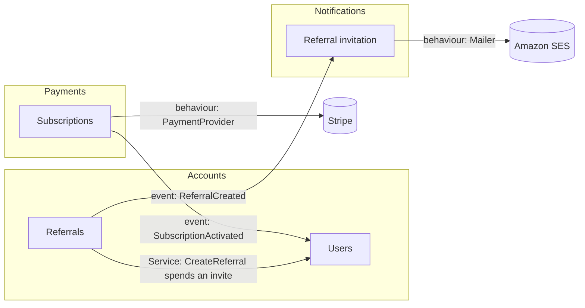

# Documentation — rule #59 in full

Rule numbers (`#38`) refer to `SKILL.md`. The worked page documents the referrals feature of `reference.md`, in its Service form (`concurrency.md`).

`docs/` is the narrative the code cannot carry. `@moduledoc`/`@doc` (#28) state the contract of *one* module; `docs/` explains how each feature works and how the features fit together, for a reader who has **not** read the code. #58 keeps prose out of the code because this is where it goes.

## The two levels

- **`docs/README.md` — the system map.** What the app is, in a paragraph; one line and a link per feature; and a mermaid `flowchart` of the contexts with **every edge between features**: an event emitted here and consumed there (#47), a Service orchestrating across contexts or sub-modules (#4), an external adapter behind a behaviour (#5). A feature that is not on the map does not exist; an edge missing from the map is a coupling nobody agreed to.
- **`docs/<context>/<feature>.md` — one living page per feature**, roughly one per sub-module or Service cluster, with these sections in this order so every page reads the same:
  1. **What it does** — 2–5 sentences: the behaviour and the rule it enforces.
  2. **How it works** — a mermaid `sequenceDiagram` of the flow (resolver → facade → Service/sub-module → `Repo` → event → handler); a `flowchart` where it branches.
  3. **Data** — a mermaid `erDiagram` of the schemas it owns; a `stateDiagram-v2` for any lifecycle field (`archived_at`, `status`, …, #9).
  4. **Interactions** — what it emits, what it consumes, which Services cross into it, each linked to *that* feature's page. Every edge listed here is on the README map, and every edge on the map touching this feature is listed here.
  5. **Errors** — the typed errors it returns (#38) and when.
  6. **Entry points** — mutations and queries, workers, handlers, with file paths.

## Writing rules

- **Mermaid wherever there is a flow, a data model or a state**, which is every feature. The diagram carries the flow; the prose carries the rules and the reasons.
- **Write for the reader, about today.** English (Rule 0), present tense, the current behaviour only; "we used to" and "changed in PR #12" are history, which git keeps (#56).
- **Describe what *this* app guarantees**, not what a client does with it (#57).
- **Explain the feature, not the code.** Function signatures and walks through `defp`s are the `@doc`'s job (#58), and rot the moment the code moves.

## The PR rule

A change to behaviour or structure updates the affected feature page(s), and the README map if an edge appeared or disappeared, **in the same PR**. A PR that changes nothing documented (formatting, a version bump) says in its description which page was checked and why it needed no change. No `docs/` diff *and* no such statement is an incomplete PR, exactly like a missing test.

A page is done when it has its six sections, a diagram for every flow, data model and state, and the same edges as the map.

## Worked page (`docs/accounts/referrals.md`) and map (`docs/README.md`)

````markdown
<!-- docs/accounts/referrals.md -->
# Referrals

## What it does

A signed-in user invites a friend by email. Each referral spends one of the referrer's invites (`users.invites_remaining`), and a referrer can refer a given email only once. Creating the referral and spending the invite succeed or fail together: a referral never exists without the invite it cost, and an invite is never spent without a referral.

## How it works



The invite is spent by one guarded `UPDATE`, never by read-then-write, so two concurrent referrals from the same user cannot both spend the last invite. The event is an Oban row written in the same transaction: it is delivered exactly once and never for a referral that was rolled back. `opts` carries the event metadata from the resolver (who triggered it, from where).

## Data



A referral has no lifecycle field, so there is no state diagram.

## Interactions

| Direction | What | Counterpart | Page |
|---|---|---|---|
| Emits | `Accounts.Events.ReferralCreated` (async, exactly once) | Notifications sends the invitation email | [Referral invitation](../notifications/referral_invitation.md) |
| Calls | `Users.claim_invite/1`, inside the `CreateReferral` transaction | Users | [Users](users.md) |

Both edges are on the [system map](../README.md#system-map).

## Errors

| Error | When | Written |
|---|---|---|
| `ReferralAlreadyExistsError` | this referrer already referred this email | nothing |
| `NoInvitesRemainingError` | `invites_remaining` is 0 | nothing — the referral insert is rolled back |
| `UnauthenticatedError` | no signed-in user | nothing |

## Entry points

- `createReferral` mutation — `lib/my_app_web/api/public/schema/mutations/accounts/referral.ex` (authenticated)
- Service — `lib/my_app/accounts/services/create_referral.ex`
- Reads — `Accounts.get_referral/2`, `Accounts.list_referrals/3` (`:referrer` preload is opt-in)
- Event — `Accounts.Events.ReferralCreated` in `lib/my_app/accounts/events.ex`
````

The system map gains the feature and its two edges. Every edge on the map is typed by how it crosses — `event:` is asynchronous via `ex_event_bus`, `Service:` is synchronous inside one transaction, `behaviour:` is an external adapter — so the map also tells the reader which couplings are hard and which are soft:

````markdown
<!-- docs/README.md (excerpt) -->
## Features

- [Users](accounts/users.md) — accounts, invites, lifecycle
- [Referrals](accounts/referrals.md) — a user invites a friend by email; spends an invite
- [Referral invitation](notifications/referral_invitation.md) — emails the invitee when a referral is created
- [Subscriptions](payments/subscriptions.md) — paid plans via Stripe

## System map


````

What makes this conventional: the page explains the *feature* — a reader learns the rule (one invite per referral, one referral per email) and the guarantee (atomic, exactly-once event) from the diagram and two sentences, without a single function signature. Every edge in Interactions is on the map, and the map's edge labels name the mechanism. When the Service of `concurrency.md` added the invite spend, the same PR changed the sequence diagram, the Users row in Interactions, the `NoInvitesRemainingError` row, and the `Service:` edge on the map — and a later PR that only reformatted `create_referral.ex` would state in its description that `docs/accounts/referrals.md` was checked and needed no change.
