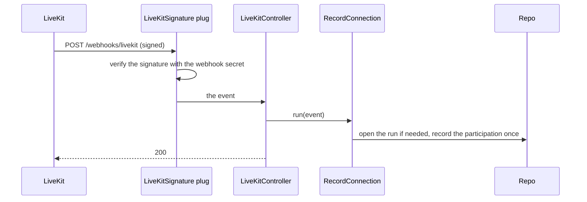

# Live sessions

## What it does

An online activity runs in a live room on the media server. A person enters it with a token that carries their role,
host or viewer; the media server adapter (`App.Live.Adapter`, LiveKit in every environment but tests) issues it.
LiveKit reports each connection in a signed webhook; a person's first connection to the current run is recorded as
their participation, with their role. Every signed event is answered 200.

## How it works

## Configuration

`config :app, :live` names the adapter. The LiveKit adapter reads `LIVEKIT_URL`, `LIVEKIT_API_KEY` and
`LIVEKIT_API_SECRET`, required at boot wherever it is the configured adapter. Webhooks are verified with
`LIVEKIT_WEBHOOK_SECRET`.
