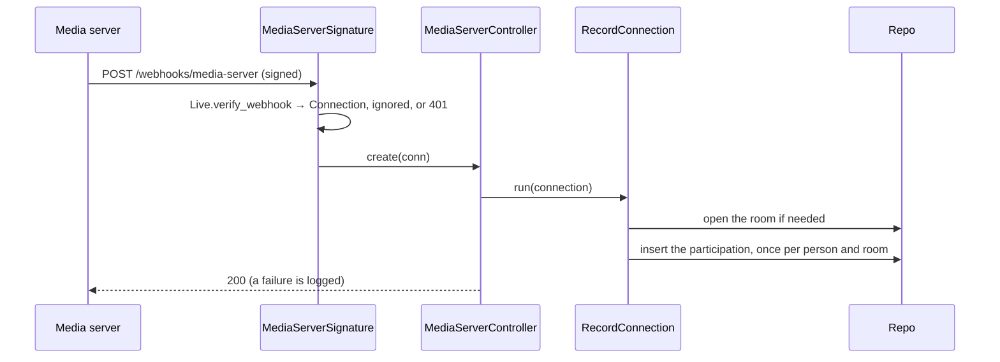
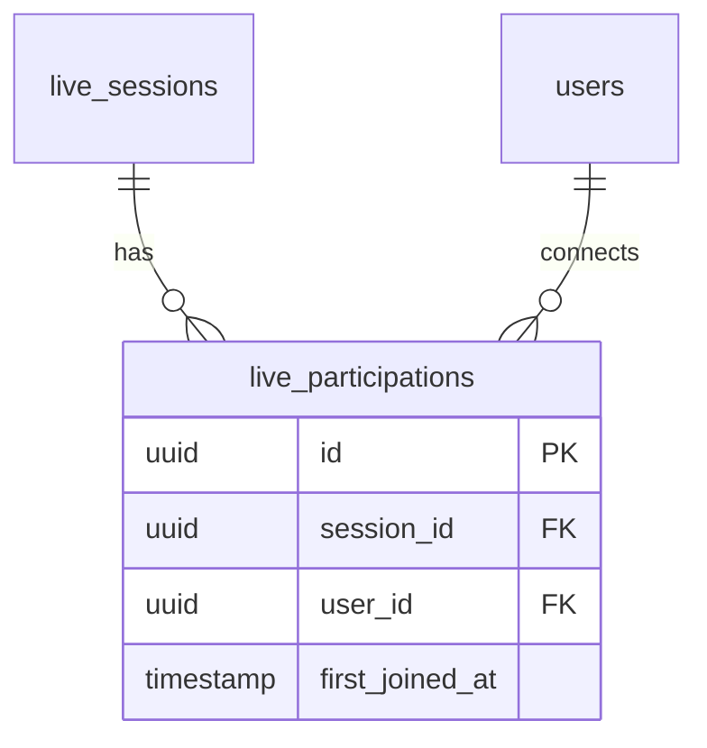

# Live sessions

## What it does

Each online activity has one live room, opened the first time someone connects to it. The media server signs every
webhook it sends; `MediaServerSignature` turns a signed connection into a `Live.Connection` through the configured
`Live.Adapter`, and refuses an unsigned body with 401. Each person's first connection to a room is recorded as their
participation, once per person and room; it publishes `LiveParticipationRecorded`, which confirms the person's
attendance. Every signed event is answered 200, so the media server does not send it
again; a connection that cannot be recorded is logged.

## How it works

## Data

## Interactions

| Direction | What | Counterpart |
|---|---|---|
| Calls | `Live.Adapter` (configured) | the media server |

## Entry points

- `POST /webhooks/media-server` — `lib/app_web/controllers/media_server_controller.ex`
