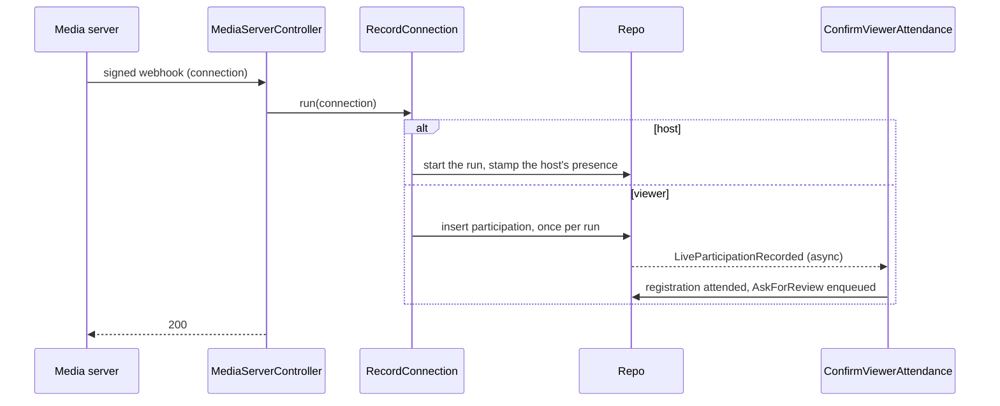

# Live sessions

## What it does

An online activity runs in a live room. Each run of the room is a session: it waits until the host (the activity's
organizer, or its creator when it has none) connects, is live while it runs, and ends once the activity is over and
the host has been away for ten minutes. A viewer's first connection to a run is their participation, and it confirms
their registration as attended, exactly as an admin would.

## How it works

Every five minutes `CheckHostPresence` asks the media server whether each live's host is still in the room and
stamps their presence or their absence; `CloseOverrunLive` ends the lives whose activity is over and whose host has
been away for ten minutes.

## Interactions

| Direction | What | Counterpart |
|---|---|---|
| Emits | `Live.Events.LiveParticipationRecorded` | Communities confirms the viewer's attendance |
| Calls | `Live.Adapter` (configured) | the media server |
