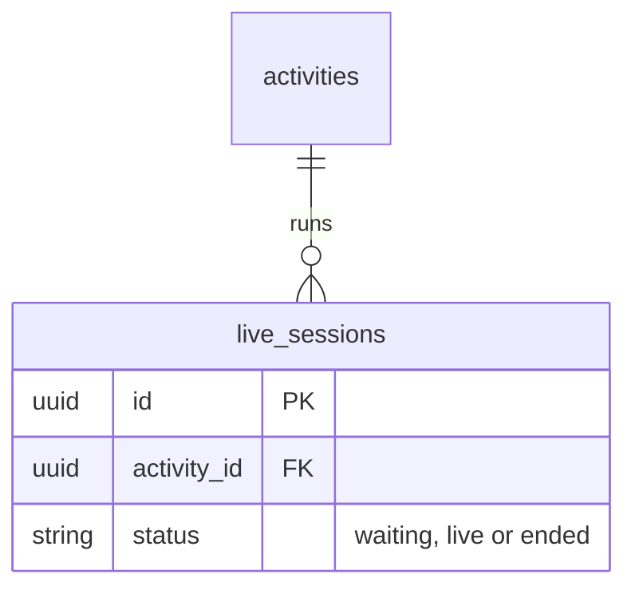
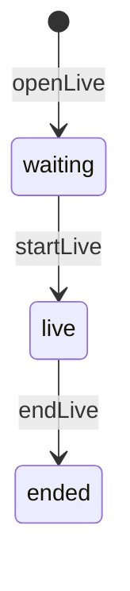

# Live sessions

## What it does

An online activity is held in a live room, hosted by a media server reached through `App.Live.Adapter` (LiveKit in
production, a mock in tests). Each run of the room is a session: the host opens it, starts it and ends it. Its host is
the organizer, or the creator of an activity without one; members holding a validated registration enter as viewers.

## Data

## Entry points

- `openLive`, `startLive`, `endLive` mutations, for the host — `lib/app_web/schema/mutations/live.ex`
