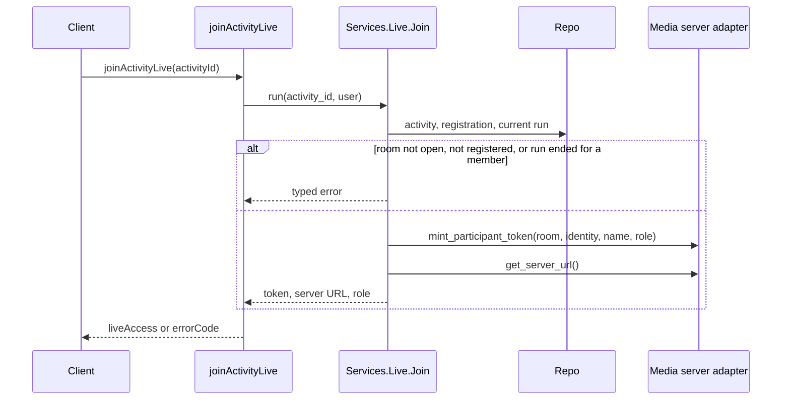
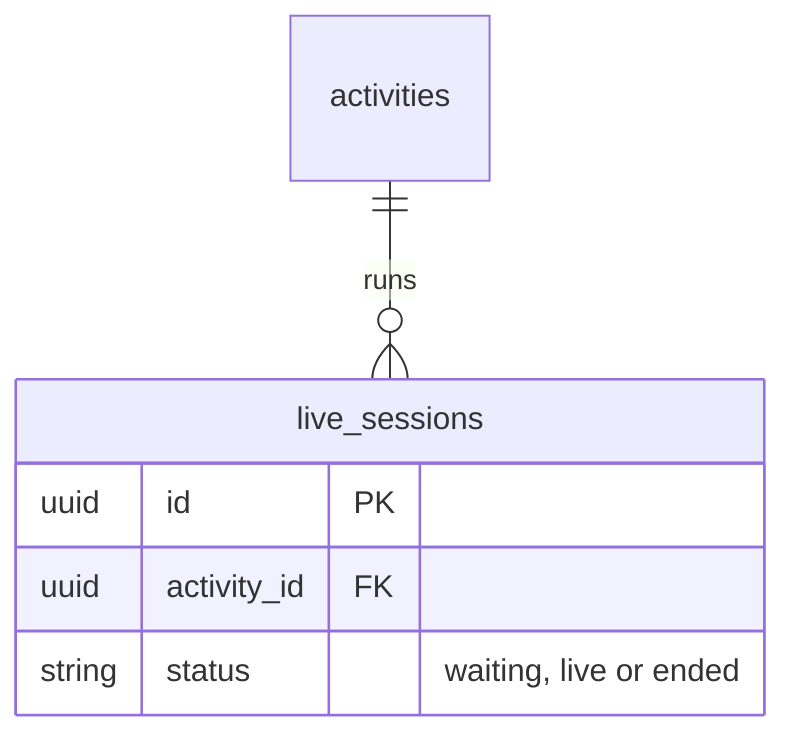
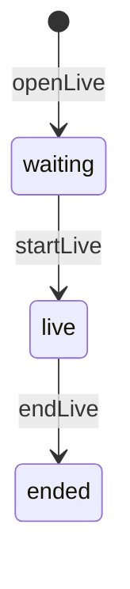

# Live sessions

## What it does

An online activity is held in a live room, hosted by a media server reached through `App.Live.Adapter` (LiveKit in
production, a mock in tests). Each run of the room is a session: the host opens it, starts it and ends it. Its host is
the organizer, or the creator of an activity without one; members holding a validated registration enter as viewers.

A person joins the room with a token and the media server's address. The room opens `LIVE_OPENS_BEFORE_MINUTES`
(15 by default) before the activity's start. Once the host has ended the current run — the activity's latest — a
member gets no token; the host still does, to start again.

## How it works

## Data

## Errors

| Error | When |
|---|---|
| `NotFoundError` | the activity does not exist |
| `LiveRoomNotOpenError` | the room is not open yet |
| `NotAnAttendeeError` | the person is neither the host nor a member with a validated registration |
| `LiveOverError` | the host has ended the current run and a member asks to join |

## Configuration

- `LIVE_OPENS_BEFORE_MINUTES` — how long before the start the room opens; 15 when unset.

## Entry points

- `openLive`, `startLive`, `endLive` mutations, for the host — `lib/app_web/schema/mutations/live.ex`
- `joinActivityLive` mutation, for any signed-in person — same file; `App.Services.Live.Join` decides
