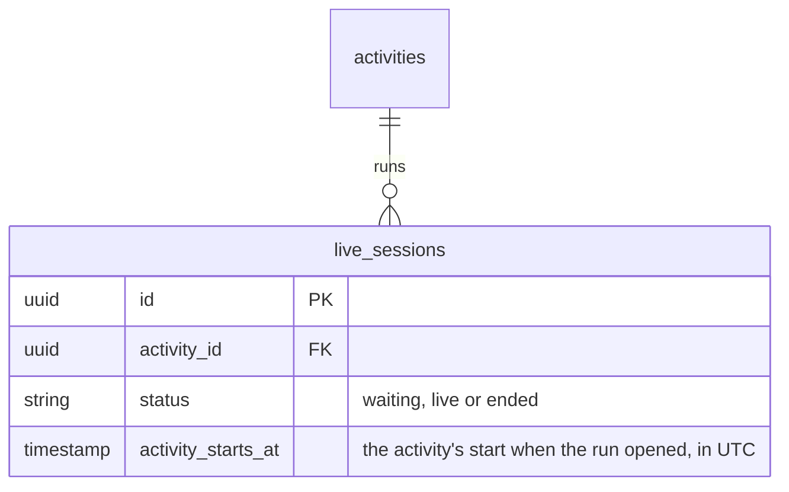
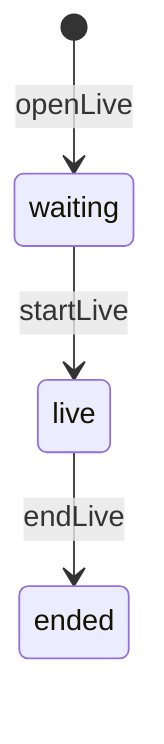

# Live sessions

## What it does

An online activity is held in a live room. Each run of the room is a session: the host opens it, starts it and ends
it. An activity's current session is its latest one.

## Data

## Entry points

- `openLive`, `startLive`, `endLive` mutations, for the activity's host — `lib/app_web/schema/mutations/live.ex`
