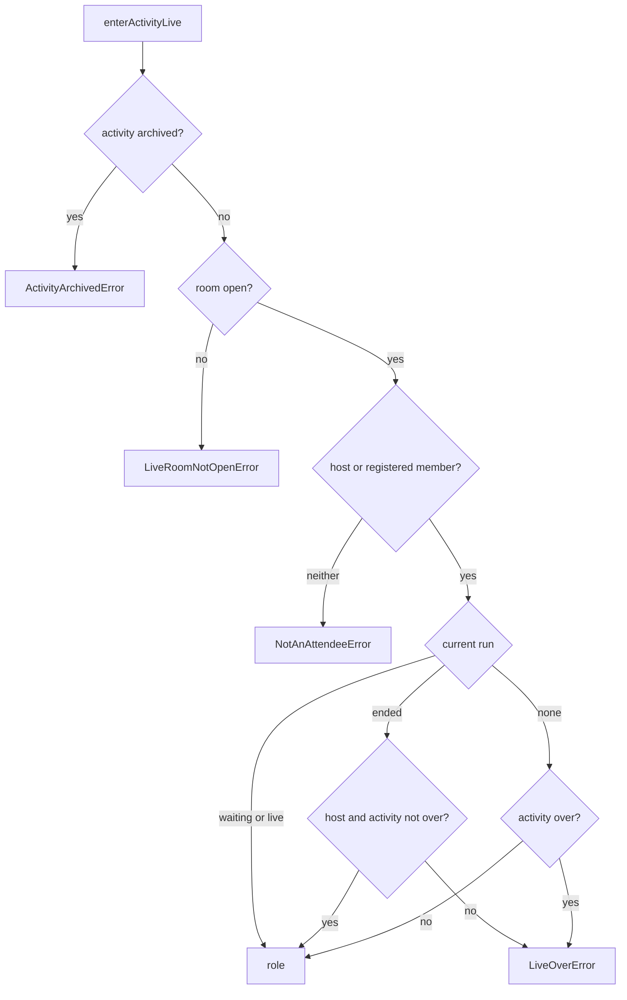
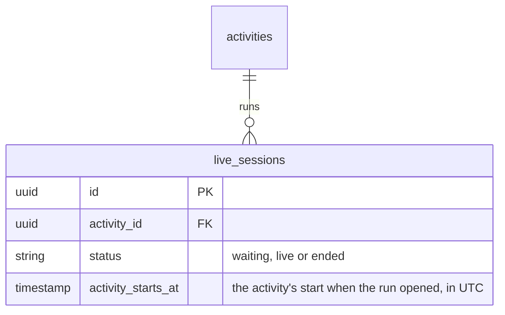
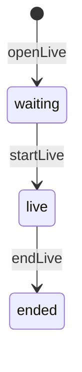

# Live sessions

## What it does

An online activity is held in a live room. Each run of the room is a session: the host opens it, starts it and ends
it. An activity's current session is its latest one, unless that run ended and the activity has been moved since it
opened: a moved activity starts over with no current session.

The host — the organizer, or the creator of an activity without one — and the members holding a validated
registration may enter the room. It opens 15 minutes before the activity's start and closes once the activity is
over, unless its live still waits or runs. Once the host has ended the run, a member may not enter; the host still may,
to start again, until the activity is over.

## How it works

## Data

`activities.starts_at` is a `timestamptz` and `live_sessions.activity_starts_at` a `timestamp` holding UTC: the query
that finds the current run reads the activity's start in UTC before comparing them.

## Errors

| Error | When |
|---|---|
| `NotFoundError` | the activity or the user does not exist |
| `ActivityArchivedError` | the activity is archived |
| `LiveRoomNotOpenError` | it is more than 15 minutes before the start |
| `NotAnAttendeeError` | the person is neither the host nor a member with a validated registration |
| `LiveOverError` | the activity is over and its live neither waits nor runs, or the host ended the run and a member enters |

## Entry points

- `openLive`, `startLive`, `endLive` mutations, for the activity's host — `lib/app_web/schema/mutations/live.ex`
- `enterActivityLive` mutation, for any signed-in person — same file; `App.Services.Live.Enter` decides
