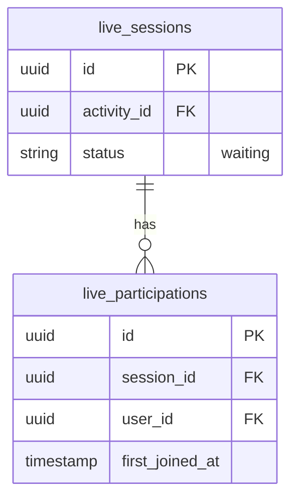

# Live sessions

## What it does

An online activity runs in a live room. The media server reports every connection; the first one opens a run of the
live, and a viewer's first connection to a run is recorded once as their participation. A participation confirms the
member's registration as attended. The host's connections are not recorded.

## Data

## Interactions

- Publishes `LiveParticipationRecorded`, consumed by Communities' `ConfirmAttendance`.
- `participantCount` on a live session counts its participations: the members who took part.
