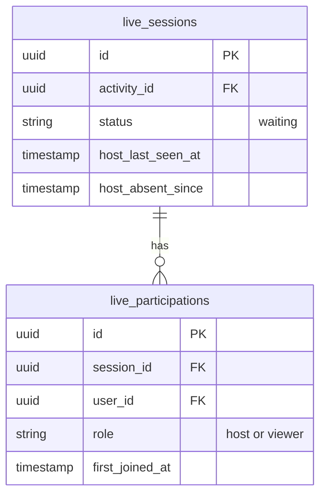

# Live sessions

## What it does

An online activity runs in a live room. The media server reports every connection; the first one opens a run of the
live, and each person's first connection to a run is recorded once as their participation, with the role they joined
as: host or viewer. A participation confirms the person's registration as attended, the host's included. The host's
connections also stamp when the host was last seen in the room. A connection to a run the host has ended is ignored.

## Data

## Interactions

- Publishes `LiveSessionCreated` when a run opens.
- Publishes `LiveParticipationRecorded`, consumed by Communities' `ConfirmAttendance`.
- `participantCount` on a live session counts its participations: the members who took part.
