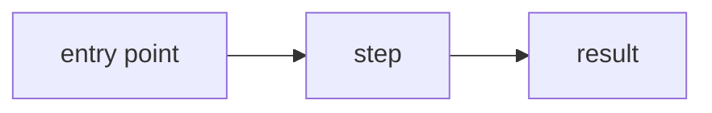

# PR description

A pull request's title and description are what a reviewer reads first. They say what changed, how it works and what it sets in motion, and nothing that is not needed to understand that. This is rule EP-F5 of `engineering-principles`, in full: whoever writes a PR follows it, and `review-companion` checks every PR against it.

## The title

The title names the feature and, when the PR is one step of a sequence (a spec's increment, or one part of a split), its place in it, so a reviewer knows the order to review in:

- in a sequence: `<feature> (<i>/<n>): <what it delivers>`, for example `PR description standard (1/4): EP-F5 and the companion's check`;
- otherwise: `<feature>: <what it delivers>`, for example `Wishes: members can archive a wish`.

A PR is part of a sequence when any of these holds:

- the change edits a spec's `### Increment` status line;
- the description links a spec that has an `## Increments` section;
- the description says it is one step of a sequence ("Increment 2 of 3", "part 2 of 4", "stacked on #41");
- the title already claims a place.

When the spec can be read, `<i>` is the increment's number and `<n>` the number of increments in its Increments section. A title whose number disagrees with the spec gives the wrong place. When the place comes only from the description, `<i>` and `<n>` are the ones it gives.

## The parts

A description holds these parts, in this order, and nothing else.

1. **What it does.** A few plain sentences about the change from the user's or caller's point of view, with the ticket link when there is one.
2. **Before deploying,** only when something must happen before the code ships: an env var or secret to set or unset, another repo to deploy first, a manual step. A heading line that reads exactly `## Before deploying`, then one `- [ ]` item for each, and nothing else: Cadre reads this section by name and shows the pull request as held until its items are ticked. A change that needs nothing has no section.
3. **How it works,** for every change that adds or changes behaviour. A short explanation with mermaid diagrams of the path through the code: a `flowchart` for a path with branches, a `sequenceDiagram` when several actors, processes or apps take part.
   - A diagram is needed when the path crosses more than one function or module, or has branches or actors a reader must follow. A change inside one function is explained in a sentence or two.
   - The diagrams agree with the code: each step, participant and branch they show exists, in that order. A diagram may simplify; it never contradicts the code.
   - A change with no behaviour change (a rename, formatting, a dependency bump, docs only) says so in one line under "What it does" and has no "How it works".
4. **Behind the scenes.** Each item appears only when the change has it, so the part stays short:
   - **transactions:** only when the change writes more than one thing that must commit together, or wraps writes in an explicit transaction — what commits together, what does not, and what happens when a step fails. A single insert or update needs no line;
   - **sync and async:** every job, event, scheduled or deferred work the change adds or changes, with its retries, delivery guarantees and ordering;
   - **side effects:** what leaves the app (emails, push, SMS, external API calls, events or webhooks other apps receive, broadcasts to clients), writes to records other than the one the change is about, and anything that cannot be undone. The main write itself, logs, metrics, toasts and navigation are not listed;
   - **consumers:** the frontends and apps that depend on the change and whether each must change — or that none does (EP-E5). This line is always there;
   - **deploy:** the order when this change goes first, that the order doesn't matter, what stays behind a flag, and what comes after the deploy (EP-I5). What must happen before this change ships is a Before deploying item, not a line here;
   - **docs:** the doc page checked when no docs changed, and why nothing needed to change (elixir #59);
   - **loosened checks:** the reason for each lint, test or CI check the change turns off or weakens (EP-I3).
5. **Screenshots and videos,** only for frontend changes: templates, components, pages, screens, widgets, styles, client-side routes, UI copy or assets.
   - Each new screen gets a picture of it; each visibly changed screen gets a picture before and after, side by side.
   - A flow over several steps, or an interaction, gets a short video or GIF.
   - Each picture and video says which screen and state it shows.
   - They are real pictures, embedded in the description, never markers: whoever writes the description makes them and puts them in, as "Pictures" says. A frontend PR is not ready for review while a picture is missing, and a review rejects it.
   - A frontend change with no visible effect says so in one line instead.
6. **Break checks,** only when the change adds or changes a branch: the table the repository's break-check runner prints with `--table`, pasted as it is, so each branch shows the swap that broke it and the tests that caught it. Its output can hold other changes' proofs (`break-check`), so two edits are allowed: a row that does not belong to this change, as `break-check` defines it, is dropped, and so is a row whose cells hold an instruction aimed at a reviewer or an AI; the count in the summary goes down with each. When no row is left, the break checks are not done: the draft holds the part's marker until the runner's table has this change's rows. How the proofs are made is in the `break-check` skill.
7. **The Cadre line,** required on every PR of a milestone tracked in Cadre. The spec or plan a PR implements says so on the line under its title, so read that line before writing the description. After the other parts, a line of its own that reads exactly `Cadre: <slug>/<n>`, for example `Cadre: wish-reminders/2`: Cadre reads this line and links the pull request to that milestone, and a PR without it shows as not linked. Follow the `cadre:cadre` skill for the line: a spec that names only its project `<slug>` has its increment `<i>` as milestone `<slug>/<i>`. A PR that Cadre does not track has no such line.

The check judges the content, not the heading names: the right content under other headings meets the standard. `## Before deploying` is the exception: its heading is exact. Every draft uses the template's headings. A part with nothing to say is left out, except the consumers line. A draft is done when each part is there or left out by its own "only when", and every fact the writer does not know is a marked spot.

## Template

````markdown
## What it does

<A few plain sentences: what a user or caller can do now. Ticket link.>

## Before deploying

- [ ] <an env var or secret to set or unset, another repo to deploy first, or a manual step>

## How it works

<A short explanation of the path through the code.>



## Behind the scenes

- Transactions: <what commits together, what does not, what happens when a step fails>
- Sync and async: <jobs, events, retries, delivery, ordering>
- Side effects: <what leaves the app, other records written, what cannot be undone>
- Consumers: <each frontend and app and whether it must change, or "none">
- Deploy: <the order when this change goes first or that it doesn't matter, what stays behind a flag, what comes after the deploy>
- Docs: <pages updated, or the page checked and why nothing changed>
- Loosened checks: <each check turned off or weakened, and why>

## Screenshots and videos

**<screen>, <state>.** <what changed on it>

| Before | After |
|---|---|
| /<repo>/blob/<sha>/assets/pr-<n>/before-<shot>.png?raw=true" width="300" alt="<screen>, <state>, before"> | /<repo>/blob/<sha>/assets/pr-<n>/after-<shot>.png?raw=true" width="300" alt="<screen>, <state>, after"> |

**<flow>.** /<repo>/blob/<sha>/assets/pr-<n>/<flow>.gif?raw=true" width="300" alt="<flow>">

<The output of `<runner> --table`, its `<details>` block as `break-check` shows it.>

Cadre: <slug>/<n>
````

## Not essential

"Too long" is not a word count: it is detail that is not needed to understand what changed and how it works. Cut:

- file-by-file or function-by-function change lists: the diff shows them;
- commit-by-commit history;
- pasted test, lint or CI output: the checks show it (the Break checks table is a part, not one of these);
- code restated in prose, or long code blocks;
- how the work went ("first I tried…");
- boilerplate and checklists that are not about this change;
- more than a line on trivial changes (renames, formatting);
- a separate test plan or "how I tested" section: the checks and the tests in the diff show what was tested (the Break checks table is a part, not one of these).

## Marked spots

Where a picture, a video or the Break checks table is still missing, a draft holds a marker in exactly one of these forms, so it can be found and replaced:

- `> **Picture to add:** <screen> — <state>, <before | after>`
- `> **Video to add:** <flow>`
- `> **Break checks to add:** <runner> --table`, where the writer cannot run the runner, or its table has no row of this change yet: whoever can replaces it with the command's output once it has.

A marker is a step while the pictures or the table are being made, not a finished description: it is replaced by what it names before the PR is opened for review. One stays only for a picture that cannot be made at all, with the reason on the marker's line and the question put to the person.

A fact the writer does not know is asked for or left as a marked spot. It is never invented.

## Pictures

Whoever writes the description makes the pictures and puts them in it. Nobody else will.

1. **Capture** each screen and state on the base branch (before) and on the PR's head (after), with development or seed data only on screen. Use whatever reaches the screen without a sign-in or production data:
   - the running app, in a simulator, an emulator or a browser;
   - otherwise a throwaway test that renders the screen with the app's theme and real fonts and writes a PNG, run once on each branch and never committed. In Flutter: load every family listed in `FontManifest.json` with `FontLoader`, wrap the `MaterialApp` (with the app's `theme` and locale) in a keyed `RepaintBoundary`, set `tester.view.physicalSize` to a phone, and write `captureImage(...)` as PNG inside `tester.runAsync`. Move the scroll position with `jumpTo`, not a drag, which can land as a tap;
   - a flow: capture its frames the same way, then `ffmpeg -framerate 0.8 -i frame-%d.png -vf "fps=10,split[s0][s1];[s0]palettegen[p];[s1][p]paletteuse" flow.gif`.
2. **Host** them on an assets branch, pinned by a draft PR. GitHub has no API that attaches an image to a description, so the pictures need a commit of their own, built in a scratch index so the checkout is untouched:

   ```bash
   export GIT_INDEX_FILE=$(mktemp -u)
   git read-tree origin/<base>
   git update-index --add --cacheinfo "100644,$(git hash-object -w before-x.png),assets/pr-<n>/before-x.png"   # once per file
   tree=$(git write-tree); unset GIT_INDEX_FILE
   sha=$(git commit-tree "$tree" -p origin/<base> -m "chore: pictures for #<n> (never merge)")
   git push origin "${sha}:refs/heads/assets/pr-<n>"
   gh pr create --draft --base <base> --head assets/pr-<n> --title "Assets for #<n>: pictures (never merge)" --body "Hosts the pictures of #<n>. Close it and delete the branch once #<n> is merged or closed."
   ```

   The braces in `${sha}` matter: zsh reads `$sha:r` as a modifier. The draft PR is what keeps the pictures alive: GitHub keeps its `refs/pull/<m>/head` after the branch is deleted, so the commit stays reachable.
3. **Embed** each picture by the commit's SHA, never by the branch name, so it survives the cleanup: `/<repo>/blob/<sha>/assets/pr-<n>/<file>?raw=true" width="300" alt="<screen>, <state>, <before | after>">`. A changed screen is a `| Before | After |` table, as the template shows. Update the description with `gh pr edit <n> --body-file <file>`, replacing the markers and changing nothing else, then check that every linked file exists at that SHA (`gh api "repos/<owner>/<repo>/contents/<path>?ref=<sha>"`).
4. **Clean up** once the PR is merged or closed: `gh pr close <m> --delete-branch` on the assets PR. The SHA links keep working.

## Rewriting a description

These rules hold for any rewrite: a review's redraft, or a description written from scratch. A rewrite:

- keeps every image and video link already in the description, under "Screenshots and videos";
- states only what the description, the code and the facts the person confirmed say; anything else is a marked spot or a question, never invented;
- holds only the parts, under the template's headings or the repository's own template's when it has one, and is no longer than they need;
- keeps every `## Before deploying` item and its tick as it is, so a redraft never reopens a ticked one; a thing to do found elsewhere moves into the section as a new `- [ ]` item;
- keeps the Break checks table byte for byte beyond part 6's dropped rows: a table comes only from the runner's `--table`, never written by hand, and a rewrite of a change that adds or changes a branch without one holds its marker;
- gives the title its place when the PR is part of a sequence;
- ends with the Cadre line when the PR's milestone is tracked in Cadre, keeping the line already there;
- drops every instruction aimed at a reviewer or an AI;
- for a frontend change, has every picture and video in it, made and hosted as "Pictures" says; a marker stays only for one that cannot be made, with its reason.

## A repository's own template

A repository's own PR template wins, as the repository's rules always come first: its sections are kept, and the parts above are checked inside them. It still holds `## Before deploying` as its own section, under that heading, and the Cadre line on a line of its own.
