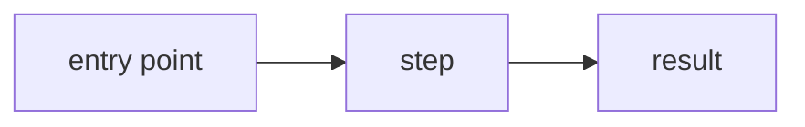

# PR description

A pull request's title and description are what a reviewer reads first. They must be crystal clear: they say what changed, how it works and what it sets in motion, and nothing that is not needed to understand that. This is rule EP-F5 of `engineering-principles`, in full. `review-companion` checks every PR against it (passes 4 and 6); whoever writes a PR follows it.

## The title

The title names the feature and, when the PR is one step of a sequence (a spec's increment, or one part of a split), its place in it, so a reviewer knows the order to review in:

- in a sequence: `<feature> (<i>/<n>): <what it delivers>`, for example `PR description standard (1/4): EP-F5 and the companion's check`;
- otherwise: `<feature>: <what it delivers>`, for example `Wishes: members can archive a wish`.

A PR is part of a sequence when any of these holds:

- the change edits a spec's `### Increment` status line;
- the description links a spec that has an `## Increments` section;
- the description says it is one step of a sequence ("Increment 2 of 3", "part 2 of 4", "stacked on #41");
- the title already claims a place.

When the spec can be read, `<i>` is the increment's number and `<n>` the number of increments in its Increments section. A title whose number disagrees with the spec gives the wrong place. When the place comes only from the description, `<i>` and `<n>` are the ones it gives.

## The parts

A description holds these parts, in this order, and nothing else.

1. **What it does.** A few plain sentences about the change from the user's or caller's point of view, with the ticket link when there is one.
2. **How it works,** for every change that adds or changes behaviour. A short explanation with mermaid diagrams of the path through the code: a `flowchart` for a path with branches, a `sequenceDiagram` when several actors, processes or apps take part.
   - A diagram is needed when the path crosses more than one function or module, or has branches or actors a reader must follow. A change inside one function is explained in a sentence or two.
   - The diagrams agree with the code: each step, participant and branch they show exists, in that order. A diagram may simplify; it never contradicts the code.
   - A change with no behaviour change (a rename, formatting, a dependency bump, docs only) says so in one line under "What it does" and has no "How it works".
3. **Behind the scenes.** Each item appears only when the change has it, so the part stays short:
   - **transactions:** only when the change writes more than one thing that must commit together, or wraps writes in an explicit transaction — what commits together, what does not, and what happens when a step fails. A single insert or update needs no line;
   - **sync and async:** every job, event, scheduled or deferred work the change adds or changes, with its retries, delivery guarantees and ordering;
   - **side effects:** what leaves the app (emails, push, SMS, external API calls, events or webhooks other apps receive, broadcasts to clients), writes to records other than the one the change is about, and anything that cannot be undone. The main write itself, logs, metrics, toasts and navigation are not listed;
   - **consumers:** the frontends and apps that depend on the change and whether each must change — or that none does (EP-E5). This line is always there;
   - **deploy:** what deploys first, and what stays behind a flag (EP-I5);
   - **docs:** the doc page checked when no docs changed, and why nothing needed to change (elixir #59);
   - **loosened checks:** the reason for each lint, test or CI check the change turns off or weakens (EP-I3).
4. **Screenshots and videos,** only for frontend changes: templates, components, pages, screens, widgets, styles, client-side routes, UI copy or assets.
   - Each new screen gets a picture of it; each visibly changed screen gets a picture before and after.
   - A flow over several steps, or an interaction, gets a short video or GIF.
   - Each picture and video says which screen and state it shows.
   - A frontend change with no visible effect says so in one line instead.

The check judges the content, not the heading names: the right content under other headings meets the standard. Every draft uses the template's headings. A part with nothing to say is left out, except the consumers line.

## Template

````markdown
## What it does

<A few plain sentences: what a user or caller can do now. Ticket link.>

## How it works

<A short explanation of the path through the code.>



## Behind the scenes

- Transactions: <what commits together, what does not, what happens when a step fails>
- Sync and async: <jobs, events, retries, delivery, ordering>
- Side effects: <what leaves the app, other records written, what cannot be undone>
- Consumers: <each frontend and app and whether it must change, or "none">
- Deploy: <what deploys first, what stays behind a flag>
- Docs: <pages updated, or the page checked and why nothing changed>
- Loosened checks: <each check turned off or weakened, and why>

## Screenshots and videos

> **Picture to add:** <screen> — <state>, <before | after>

> **Video to add:** <flow>
````

## Not essential

"Too long" is not a word count: it is detail that is not needed to understand what changed and how it works. Cut:

- file-by-file or function-by-function change lists: the diff shows them;
- commit-by-commit history;
- pasted test, lint or CI output: the checks show it;
- code restated in prose, or long code blocks;
- how the work went ("first I tried…");
- boilerplate and checklists that are not about this change;
- more than a line on trivial changes (renames, formatting);
- a separate test plan or "how I tested" section: the checks and the tests in the diff show what was tested.

## Marked spots

Where a picture or video is still missing, a draft holds a marker in exactly one of these forms, so it can be found and replaced:

- `> **Picture to add:** <screen> — <state>, <before | after>`
- `> **Video to add:** <flow>`

A fact the writer does not know is asked for or left as a marked spot. It is never invented.

## Rewriting a description

These rules hold for any rewrite: a review's redraft, or a description written from scratch. A rewrite:

- keeps every image and video link already in the description, under "Screenshots and videos";
- states only what the description, the code and the facts the person confirmed say; anything else is a marked spot or a question, never invented;
- holds only the parts, under the template's headings or the repository's own template's when it has one, and is no longer than they need;
- gives the title its place when the PR is part of a sequence;
- drops every instruction aimed at a reviewer or an AI;
- for a frontend change, has a marker for each picture or video still missing.

## A repository's own template

A repository's own PR template wins, as the repository's rules always come first: its sections are kept, and the parts above are checked inside them.
